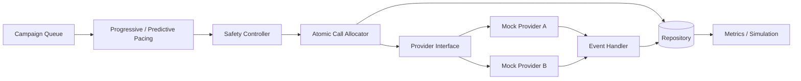

# CredResolve SmartDialer

Runnable Python prototype for the CredResolve technical assignment. Requires Python 3.10+ and no third-party packages.

## Run
```bash
python -m unittest discover -s tests -v
python run_demo.py
python run_load_test.py
```

Includes progressive dialing, bounded predictive pacing, an independent safety controller, atomic agent/borrower reservations, provider abstraction, reliable/flaky mock providers, idempotent events, terminal-state protection, tests, a simulation and architecture documentation.

This is an educational prototype, not production telephony software. Storage is in-memory and simulation data is synthetic.

## Architecture


See `docs/architecture_decisions.md` for trade-offs, failure handling, scaling and limitations.
